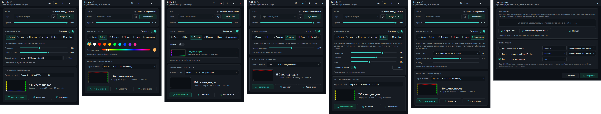

# ReLight

**English** · [Русский](#русский)

Screen backlight for Adalight LED strips (Arduino) on Windows — the colors of the screen, music, cinema and rainbow effects on the wall behind your TV or monitor.



## Download

Get the latest `ReLight.exe` on the [Releases](../../releases) page.  
It is a **self-contained** build — no need to install .NET.

## Features

- **Screen** — the strip repeats the colors along the edges of the screen (fast DXGI capture, GDI as a fallback)
- **Cinema** — skips black bars, reads deeper into the picture and gently breathes with the sound; a test window shows exactly what the strip reads
- **Music** — the strip reacts to what the computer plays
- **Microphone** — voice waves and rings on claps
- **Color** — one steady color, with almost no load on the computer
- **Rainbow effects** — 14 effects with their own palettes, an editor and a playlist
- **Exclusions** — a chosen mode for games (Unity and Unreal Engine games are found automatically) and the cinema mode for video players in focus
- **Easy setup** — finds the strip's port by itself and follows it, a running-dot test to count the LEDs, a calibration screen
- **Tray and hotkeys** — on/off and mode switching from the tray menu or with global hotkeys
- **Autostart, dark and light themes, English and Russian**

## Building from source

**Requires:** [.NET 8 SDK](https://dotnet.microsoft.com/download/dotnet/8.0) (or newer).

```bash
# Clone the repository
git clone https://github.com/dinosmike/ReLight.git
cd ReLight

# Publish a single executable (self-contained)
dotnet publish src/ReLight/ReLight.csproj -c Release -r win-x64 --self-contained true ^
    -p:PublishSingleFile=true -p:IncludeNativeLibrariesForSelfExtract=true ^
    -p:EnableCompressionInSingleFile=true -p:DebugType=None -o publish

# Or just run the script
build-release.bat
```

The ready `ReLight.exe` is in the `publish/` folder.

## Stack

- **WPF** (.NET 8, Windows only)
- **Vortice.DXGI / Direct3D11** — screen capture
- **NAudio** — sound and microphone
- **System.IO.Ports** — talking to the strip (Adalight protocol)

## License

Provided "as is" for personal and educational use.

## Author

**Mikhail Krylov** — [Telegram](https://t.me/mihail_krylov) · [GitHub](https://github.com/dinosmike)

---

## Русский

Подсветка экрана для лент Adalight (Arduino) в Windows — цвета экрана, музыка, кино и переливы на стене за телевизором или монитором.

## Скачать

На странице [Releases](../../releases) возьмите последний `ReLight.exe`.  
Сборка **self-contained** — отдельно ставить .NET не нужно.

## Возможности

- **Экран** — лента повторяет цвета по краям экрана (быстрый захват DXGI, запасной — GDI)
- **Кино** — пропускает чёрные полосы, читает цвета глубже в кадре и мягко «дышит» со звуком; тестовое окно показывает, что именно читает лента
- **Музыка** — лента реагирует на то, что играет компьютер
- **Микрофон** — волны от голоса и кольца от хлопков
- **Цвет** — один ровный цвет, почти без нагрузки на компьютер
- **Переливы** — 14 эффектов со своими палитрами, редактор и плейлист
- **Исключения** — свой режим для игр (игры на Unity и Unreal Engine находятся сами) и режим кино для видеоплееров в фокусе
- **Простая настройка** — сама находит порт ленты и следит за ним, бегущая точка для подсчёта светодиодов, экран калибровки
- **Трей и горячие клавиши** — включение, выключение и смена режима из меню в трее или глобальными клавишами
- **Автозапуск, тёмная и светлая темы, русский и английский**

## Сборка из исходников

**Нужно:** [.NET 8 SDK](https://dotnet.microsoft.com/download/dotnet/8.0) (или новее).

```bash
# Клонировать репозиторий
git clone https://github.com/dinosmike/ReLight.git
cd ReLight

# Опубликовать один исполняемый файл (self-contained)
dotnet publish src/ReLight/ReLight.csproj -c Release -r win-x64 --self-contained true ^
    -p:PublishSingleFile=true -p:IncludeNativeLibrariesForSelfExtract=true ^
    -p:EnableCompressionInSingleFile=true -p:DebugType=None -o publish

# Или просто запустить скрипт
build-release.bat
```

Готовый `ReLight.exe` лежит в папке `publish/`.

## Стек

- **WPF** (.NET 8, только Windows)
- **Vortice.DXGI / Direct3D11** — захват экрана
- **NAudio** — звук и микрофон
- **System.IO.Ports** — связь с лентой (протокол Adalight)

## Лицензия

Проект распространяется «как есть» для личного и учебного использования.

## Автор

**Михаил Крылов** — [Telegram](https://t.me/mihail_krylov) · [GitHub](https://github.com/dinosmike)
